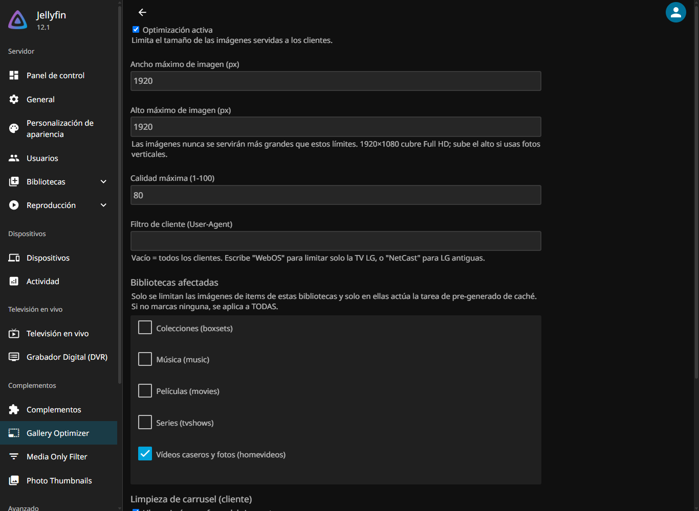

# Jellyfin.Plugin.GalleryOptimizer

Plugin para **Jellyfin** que mejora la eficiencia de las galerías de fotos en
clientes con poca RAM (smart TVs **webOS**, LG NetCast, navegadores antiguos…).

## El problema

Cuando la TV pide una foto, Jellyfin puede servir la imagen **original**
(p. ej. 6000×4000 o un HEIC de varios MB). El cliente decodifica el bitmap
completo en memoria — y en un carrusel se van acumulando decenas de ellos —
hasta que webOS se queda sin RAM y la app se cierra o se congela.



## Qué hace

Actúa en tres niveles, combinables:

### 1. Limitación de tamaño en servidor (middleware)

`ImageClampMiddleware` (registrado vía `IStartupFilter` +
`IPluginServiceRegistrator`) intercepta cada petición `*/Images/*` y reescribe
la query string:

- `width`/`fillWidth`/`maxWidth` → se acotan a `MaxWidth`;
  `height`/`fillHeight`/`maxHeight` → a `MaxHeight`.
- Si el cliente pide la **imagen original** (sin tamaño) → se inyectan
  `maxWidth`/`maxHeight` con el tope configurado.
- `quality` se acota al máximo configurado.
- **Ámbito por biblioteca**: el middleware extrae el `itemId` de la URL,
  resuelve su biblioteca raíz con `ILibraryManager` (con caché de 10 min por
  item) y solo limita imágenes de las bibliotecas seleccionadas.
  **Lista vacía = se aplica a todas**.
- **Filtro de cliente**: si configuras un texto (p. ej. `WebOS`), solo las
  peticiones cuyo User-Agent lo contiene se ven afectadas.

Resultado: Jellyfin siempre devuelve una versión redimensionada ligera → la
TV decodifica bitmaps pequeños → mucha menos RAM por imagen.

### 2. Limpieza del carrusel en el cliente

El middleware sirve `/GalleryOptimizer/carousel-cleanup.js` y lo inyecta en
las páginas `index.html` de jellyfin-web (la app webOS lo carga igual). El
script:

- Observa todos los `` con `IntersectionObserver`.
- Cuando una imagen sale del viewport y hay más de `MaxLoadedImages`
  (def. 30) retenidas, su `src` se sustituye por un **píxel transparente** →
  el navegador libera el bitmap decodificado de la RAM.
- Al volver a entrar en pantalla restaura el `src` original.
- Un barrido cada 5 s purga nodos eliminados del DOM y libera los más
  antiguos.

### 3. Pre-generación de caché (tarea programada)

"Pre-generar imágenes optimizadas de galería" recorre las fotos
(`BaseItemKind.Photo`) de las bibliotecas seleccionadas y llama a
`IImageProcessor.ProcessImage` con el tope configurado, llenando
`cache/images/resized-images` por adelantado — evita el redimensionado en
caliente la primera vez que la TV pide cada foto.

## Configuración

En **Panel → Plugins → Gallery Optimizer**:

| Opción | Por defecto | Descripción |
|---|---|---|
| Optimización activa | ✅ | Activa el middleware de limitación. |
| Ancho máximo (px) | `1920` | Tope de ancho servido. |
| Alto máximo (px) | `1920` | Tope de alto servido. 1920×1080 cubre Full HD; sube el alto si usas fotos verticales. |
| Calidad máxima (1-100) | `80` | Calidad JPEG de las versiones reducidas. |
| Filtro de cliente | *(vacío)* | Substring del User-Agent. Vacío = todos; `WebOS` = solo la TV LG; `NetCast` = LG antiguas. |
| Bibliotecas afectadas | *(vacío = todas)* | Limita imágenes de items de estas bibliotecas; también es el alcance de la tarea de caché. |
| Liberar imágenes fuera del viewport | ✅ | Inyecta el script de limpieza de carrusel. |
| Imágenes máx. retenidas | `30` | Umbral de bitmaps retenidos antes de liberar los más antiguos. |

Tras guardar, ejecuta la tarea manualmente en **Panel → Tareas programadas**
para pre-calentar la caché.

## Instalación

### Opción A — Repositorio de plugins (recomendada)

1. **Panel → Plugins → Repositories → +** y añade:
   `https://nen155.github.io/jellyfin-plugins-repo/manifest.json`
2. Instala **Gallery Optimizer** desde el catálogo y reinicia Jellyfin.

### Opción B — Manual

1. Detén Jellyfin.
2. Crea `<directorio de datos>\plugins\GalleryOptimizer\`
   (Windows portable: `\Jellyfin\Data\plugins\GalleryOptimizer\`;
   instalador: `%ProgramData%\Jellyfin\Server\plugins\GalleryOptimizer\`;
   Docker: `<config>/plugins/GalleryOptimizer/`).
3. Copia dentro `Jellyfin.Plugin.GalleryOptimizer.dll` y reinicia.

## Limitaciones conocidas

- El script de limpieza actúa sobre **elementos `` reales**; si alguna
  vista de jellyfin-web usa `background-image` CSS, esos bitmaps no se
  liberan.
- Sustituir el `src` provoca una recarga al volver a la imagen, casi
  instantánea porque el servidor ya la tiene reducida y en caché.
- Los archivos originales en disco **nunca** se modifican.

## Compilación

Requiere **.NET SDK 10**:

```powershell
dotnet publish -c Release
```

El ensamblado queda en
`bin\Release\net10.0\publish\Jellyfin.Plugin.GalleryOptimizer.dll`.

## Compatibilidad

- Compilado contra **Jellyfin 12.1** (`net10.0`; `targetAbi: 12.1.0.0`).

## Licencia

[GPL-2.0](LICENSE)
