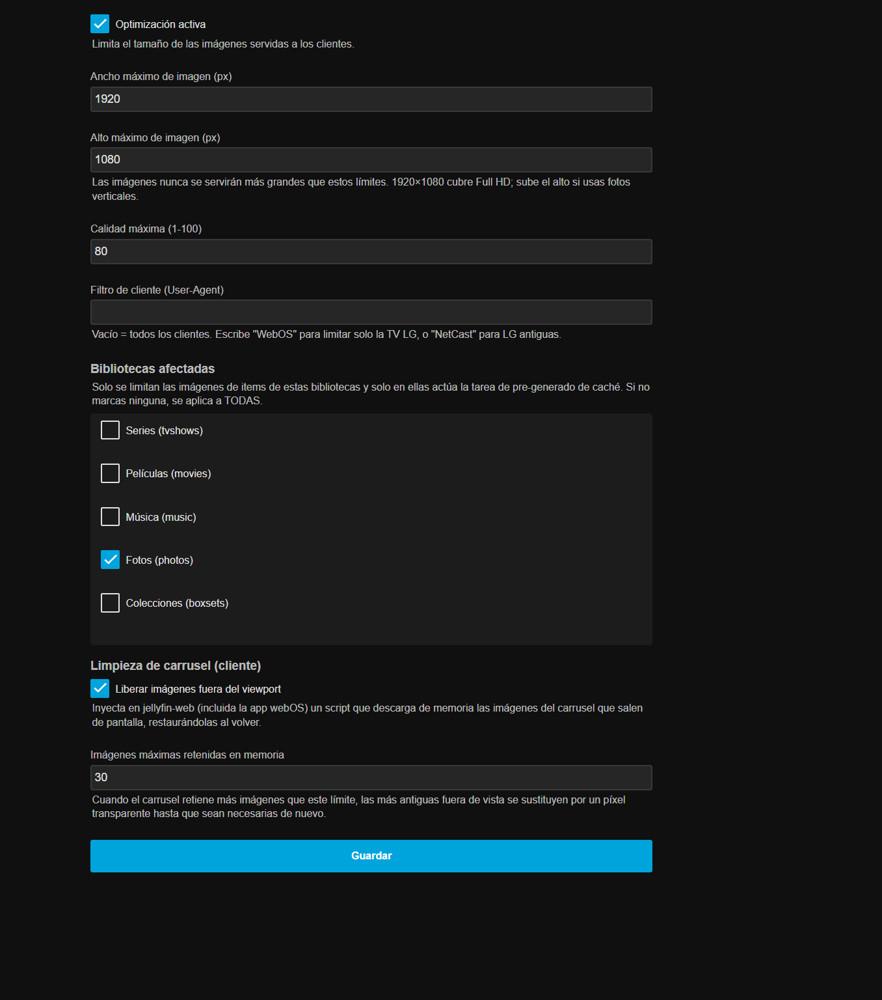

# Jellyfin.Plugin.GalleryOptimizer

<p align="center">
  
</p>

Plugin para **Jellyfin** que mejora la eficiencia de las galerías de fotos en
clientes con poca RAM (smart TVs **webOS**, LG NetCast, navegadores antiguos…).

## El problema

Cuando la TV pide una foto, Jellyfin puede servir la imagen **original**
(p. ej. 6000×4000 o un HEIC de varios MB). El cliente decodifica el bitmap
completo en memoria — y en un carrusel se van acumulando decenas de ellos —
hasta que webOS se queda sin RAM y la app se cierra o se congela.



## Qué hace

Actúa en tres niveles, combinables:

### 1. Redimensionado en servidor (middleware)

`ImageClampMiddleware` (registrado vía `IStartupFilter` +
`IPluginServiceRegistrator`) intercepta las peticiones de imagen y reescribe
la URL antes de que llegue al pipeline de Jellyfin.

**a) Descargas de fotos → pipeline de imágenes.** El reproductor de fotos de
jellyfin-web no pide `/Items/{id}/Images/Primary`: cuando el usuario tiene
permiso de descarga pide `/Items/{id}/Download`, es decir **el fichero
original**. Un JPEG de 6000×4000 decodificado ocupa ~96 MB de RAM; con dos o
tres fotos el televisor se queda sin memoria y reinicia la app. El middleware
detecta esa petición (solo si el `Accept` es de imagen, para no romper las
descargas reales), comprueba que el item es una foto y la traduce a
`/Items/{id}/Images/Primary?maxWidth=…&maxHeight=…&quality=…`.

**b) Acotado de tamaño/calidad.** En cualquier ruta `*/Images/*`:

- `width`/`fillWidth`/`maxWidth` → se acotan a `MaxWidth`;
  `height`/`fillHeight`/`maxHeight` → a `MaxHeight`.
- Si el cliente pide la **imagen original** (sin tamaño) → se inyectan
  `maxWidth`/`maxHeight` con el tope configurado.
- `quality` se acota al máximo configurado.

**Ámbito**: el middleware extrae el `itemId` de la URL, resuelve su biblioteca
raíz con `ILibraryManager` (caché de 10 min por item) y solo actúa sobre las
bibliotecas seleccionadas. **Lista vacía = todas**. Además, si configuras un
texto en el filtro de cliente (p. ej. `Web0S`), solo se ven afectadas las
peticiones cuyo User-Agent lo contiene.

Resultado: el cliente decodifica bitmaps de 1080p (~8 MB) en lugar de
originales de decenas de MB.

### 2. Gobernador de memoria del carrusel (cliente)

El middleware sirve `/GalleryOptimizer/carousel-cleanup.js` y lo inyecta en el
documento SPA de jellyfin-web (la app de webOS es un envoltorio que carga la
interfaz servida por el servidor, así que el script sí se ejecuta).

El script (`Client/carousel-cleanup.js`) mantiene acotado el número de
bitmaps decodificados:

- Observa todos los `` con `IntersectionObserver` y detecta los que se
  crean después con `MutationObserver`.
- **Siempre** libera las imágenes que quedan fuera del DOM. Es el caso clave:
  el visor de fotos usa Swiper con slides virtuales y `cache: true`, de modo
  que cada foto ya vista se queda en un `` desconectado pero vivo, con su
  bitmap decodificado.
- Las imágenes fuera del viewport se sustituyen por un **píxel transparente**
  y se conservan como máximo `MaxLoadedImages` (política LRU). Las visibles
  nunca se liberan.
- Al volver a pantalla se restaura la URL original (recarga desde la caché
  HTTP, ya reducida por el punto 1).
- `pagehide` libera todo de golpe.

### 3. Pre-generación de caché (tarea programada)

"Pre-generar imágenes optimizadas de galería" recorre las fotos
(`BaseItemKind.Photo`) de las bibliotecas seleccionadas y llama a
`IImageProcessor.ProcessImage` con el tope configurado, llenando
`cache/images/resized-images` por adelantado — evita el redimensionado en
caliente la primera vez que la TV pide cada foto.

## Configuración

En **Panel → Plugins → Gallery Optimizer**:

| Opción | Por defecto | Descripción |
|---|---|---|
| Optimización activa | ✅ | Activa el middleware de limitación. |
| Redimensionar descargas de fotos | ✅ | Traduce `/Items/{id}/Download` de fotos a la ruta de imagen redimensionada. |
| Ancho máximo (px) | `1920` | Tope de ancho servido. |
| Alto máximo (px) | `1080` | Tope de alto servido. 1080p es lo máximo que muestra un televisor; un bitmap así ocupa ~8 MB. |
| Calidad máxima (1-100) | `80` | Calidad JPEG de las versiones reducidas. |
| Filtro de cliente | *(vacío)* | Substring del User-Agent. Vacío = todos; `Web0S` (con cero) = solo la app LG; `NetCast` = LG antiguas. |
| Bibliotecas afectadas | *(vacío = todas)* | Limita imágenes de items de estas bibliotecas; también es el alcance de la tarea de caché. |
| Liberar imágenes fuera del viewport | ✅ | Inyecta el script de limpieza de carrusel. |
| Imágenes extra retenidas | `2` | Imágenes *fuera de pantalla* que el cliente puede seguir conservando. |

Tras guardar, ejecuta la tarea manualmente en **Panel → Tareas programadas**
para pre-calentar la caché.

> **Actualizando desde 1.1:** la configuración guardada se conserva, así que
> los valores antiguos (`MaxHeight = 1920`, `MaxLoadedImages = 30`) siguen
> activos. Entra en la página del plugin y pon **alto máximo 1080** e
> **imágenes extra retenidas 2**; de lo contrario el cliente seguirá
> reteniendo ~440 MB de bitmaps y se reiniciará igual.

## Instalación

### Opción A — Repositorio de plugins (recomendada)

1. **Panel → Plugins → Repositories → +** y añade:
   `https://nen155.github.io/jellyfin-plugins-repo/manifest.json`
2. Instala **Gallery Optimizer** desde el catálogo y reinicia Jellyfin.

### Opción B — Manual

1. Detén Jellyfin.
2. Crea `<directorio de datos>\plugins\GalleryOptimizer\`
   (Windows portable: `\Jellyfin\Data\plugins\GalleryOptimizer\`;
   instalador: `%ProgramData%\Jellyfin\Server\plugins\GalleryOptimizer\`;
   Docker: `<config>/plugins/GalleryOptimizer/`).
3. Copia dentro `Jellyfin.Plugin.GalleryOptimizer.dll` y reinicia.

## Limitaciones conocidas

- El script de limpieza actúa sobre **elementos `` reales**. Las vistas
  que pintan la imagen con `background-image` CSS (backdrops, pósteres de
  algunas tarjetas) no se liberan; son imágenes sueltas, no acumulativas.
- Sustituir el `src` provoca una recarga al volver a la imagen, casi
  instantánea porque el servidor ya la tiene reducida y en caché.
- Los archivos originales en disco **nunca** se modifican.
- Navegadores sin `IntersectionObserver` (webOS 3.x) usan un barrido por
  scroll cada 300 ms, menos eficiente pero funcional.

## Compilación

Requiere **.NET SDK 10**:

```powershell
dotnet publish -c Release
```

El ensamblado queda en
`bin\Release\net10.0\publish\Jellyfin.Plugin.GalleryOptimizer.dll`.

## Compatibilidad

- Compilado contra **Jellyfin 12.1** (`net10.0`; `targetAbi: 12.1.0.0`).

## Licencia

[GPL-2.0](LICENSE)
